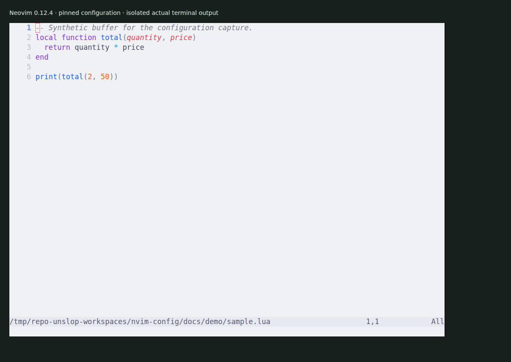

# Neovim configuration

Personal TOML-based editor settings with pinned autoconf.nvim, themekit.nvim and workbench.nvim submodules. Third-party plugins and language servers are managed separately through Nix.



The [capture](docs/demo/README.md) shows the pinned configuration running in Neovim 0.12.4. It checks editor startup and theme loading, not every language or plugin.

## Try without replacing your configuration

Use Neovim 0.12.4 to reproduce the captured environment, plus Git. The current LSP path uses Neovim 0.11 APIs; older releases are not qualified by this check.

```sh
git clone https://github.com/olegpustovit/nvim-config.git
cd nvim-config
git -c url.https://github.com/.insteadOf=git@github.com: submodule update --init --recursive
preview_root=$(mktemp -d)
mkdir -p "$preview_root/config"
ln -s "$PWD" "$preview_root/config/nvim"
XDG_CONFIG_HOME="$preview_root/config" XDG_DATA_HOME="$preview_root/data" XDG_STATE_HOME="$preview_root/state" XDG_CACHE_HOME="$preview_root/cache" nvim docs/demo/sample.lua
```

The command uses a separate XDG directory tree. The per-command Git URL rewrite lets public submodules download over HTTPS while preserving their configured SSH URLs and pinned revisions.

## Configuration and dependencies

[config.toml](config.toml) holds editor settings and keys, [languages.toml](languages.toml) holds language configuration, and [themes](themes/) contains TOML themes. The checked-in theme is `catppuccin_latte`. `:ThemePicker` opens the theme selector; Space then t invokes it through the configured mapping.

A source clone includes only the custom submodules. Install the third-party plugins and language tools needed for your workflow separately. [The Nix reference](docs/configuration.md) explains the Home Manager integration. Merely listing a language server does not install or validate it.

Workbench Files and Search mappings require an explicitly enabled and qualified Workbench runtime. This cleanup does not change its rollout gates, gitlinks or flake pins. See [AGENTS.md](AGENTS.md) before enabling it or updating plugin revisions.

The isolated startup loaded the theme and picker command without an initialization error. Language-server attachment, completion, formatting, Workbench runtime, Nix installation and startup-performance targets were not tested. `make sync` stages and pushes across repositories and updates inputs; it is not an installation command.
